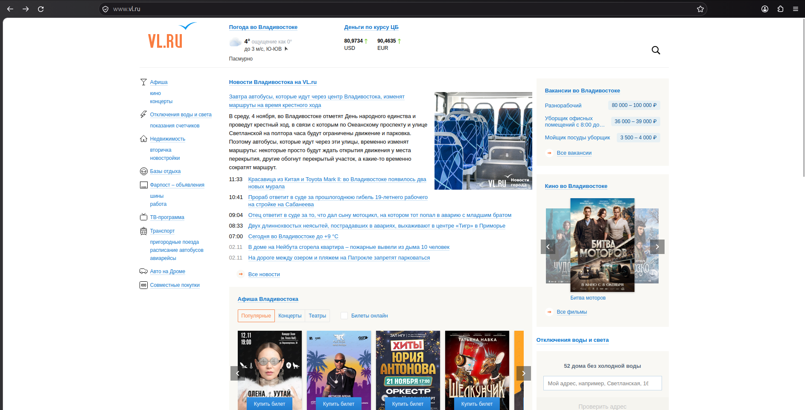
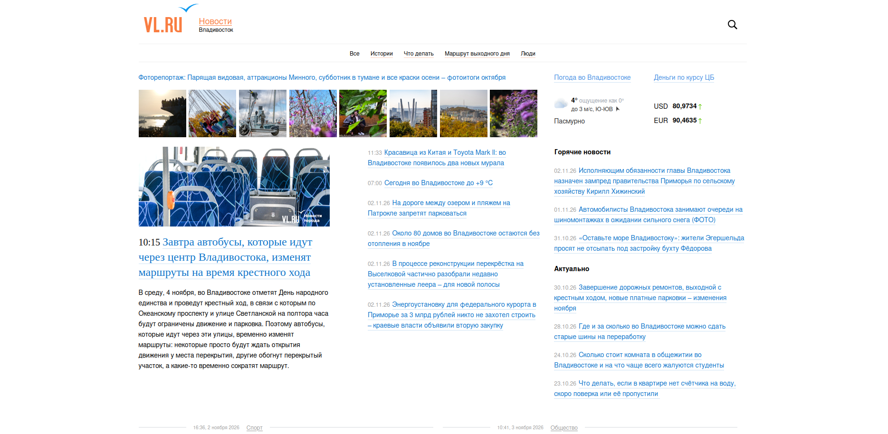
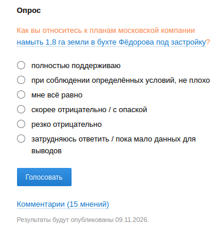
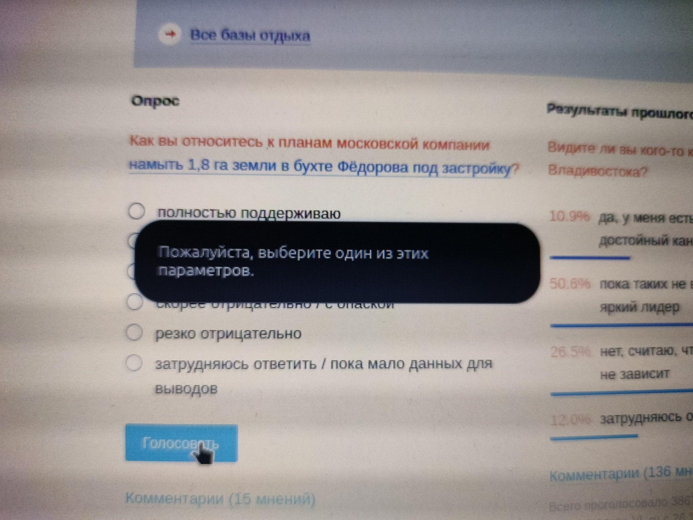

# Выполнение тест-кейсов: vl.ru

**Тестируемый сайт:** https://vl.ru
**Тестировщик:** chizuru-Ichin0se
**Ветка:** `Staging(chizuru-Ichin0se)`
**Дата тестирования:** [03.11.2026]
**Выполненные тест-кейсы:** TC-06, TC-07

---

## 1. Окружение

| Параметр | Значение |
|---|---|
| Операционная система | [linux mint] |
| Браузер | [firefox] |
| Разрешение экрана | [1920×1080] |
| Тип подключения | [Wi-Fi] |

---

## 2. Сводка результатов

| ID | Название | Приоритет | Статус |
|---|---|---|---|
| TC-06 | Открытие новости из ленты | High | [Pass] |
| TC-07 | Голосование в опросе без выбора варианта ответа | Medium | [Pass] |

**Итого:** выполнено 2 из 2, успешно — [2], с ошибкой — [0].

---

## 3. TC-06. Открытие новости из ленты

**Модуль:** Новости
**Приоритет:** High

### Предусловия
- Есть подключение к интернету.
- Главная страница https://vl.ru открыта.
- В блоке «Новости Владивостока на VL.ru» на главной странице есть новости.

### Тестовые данные
Первая новость в ленте.

### Шаги
1. Открыть https://vl.ru и дождаться полной загрузки страницы.
2. Найти блок «Новости Владивостока на VL.ru» и запомнить заголовок первой новости.
3. Кликнуть по заголовку первой новости.
4. Дождаться загрузки страницы новости.
5. Сравнить заголовок на странице новости с заголовком в ленте.
6. Проверить наличие текста, даты публикации и изображения.

### Ожидаемый результат
Открывается страница новости (на сайте newsvl.ru) с тем же заголовком, текстом, датой публикации и изображением. Ошибок 404 и 500 нет.

### Фактический результат
[После клика по заголовку первой новости в блоке «Новости Владивостока на VL.ru» открылась страница новости на сайте newsvl.ru. Заголовок совпадает с заголовком в ленте, на странице отображаются текст новости, дата публикации и изображение. Ошибок 404 и 500 не возникло.]

### Скриншоты
Лента новостей на главной странице:



Открытая страница новости:



### Статус
**[ЗАПОЛНИТЬ: Pass]**

---

## 4. TC-07. Голосование в опросе без выбора варианта ответа

**Модуль:** Опрос
**Приоритет:** Medium

### Предусловия
- Есть подключение к интернету.
- Главная страница https://vl.ru открыта.
- На странице виден блок «Опрос» с вариантами ответа и кнопкой «Голосовать».
- Вы ещё не голосовали в этом опросе.

### Тестовые данные
Вариант ответа не выбран.

### Шаги
1. Открыть https://vl.ru и дождаться полной загрузки страницы.
2. Прокрутить страницу до блока «Опрос».
3. Не выбирая ни один вариант ответа, нажать кнопку «Голосовать».
4. Проверить реакцию страницы: появилось ли сообщение, засчитался ли голос, нет ли ошибок.

### Ожидаемый результат
Голос не засчитывается. Показано сообщение о необходимости выбрать вариант ответа (либо кнопка неактивна). Ошибок на странице нет.

### Фактический результат
[После нажатия кнопки «Голосовать» без выбора варианта ответа браузер Firefox показал всплывающее предупреждение «Пожалуйста, выберите один из этих параметров». Голос не засчитан, результаты опроса не изменились, ошибок на странице не возникло.]

### Скриншоты
Блок «Опрос» до нажатия кнопки:



Результат после нажатия «Голосовать»:



### Статус
**[ЗАПОЛНИТЬ: Pass]**

---

## 5. Баг-репорты

> «Дефектов не обнаружено». 

## 6. Выводы

[Тест-кейсы TC-06 и TC-07 выполнены, оба пройдены успешно (Pass). Открытие новости из ленты работает корректно: заголовок, текст, дата и изображение отображаются. Проверка опроса без выбора ответа работает как ожидалось: сайт не засчитывает голос и показывает подсказку пользователю. Критичных дефектов не обнаружено.]

---

## 7. Структура репозитория

```
├── README.md
├── test_cases_vl_ru.xlsx      # таблица тест-кейсов
└── screenshots/               # скриншоты выполнения
    ├── tc06_feed.png
    ├── tc06_news.png
    ├── tc07_poll.png
    └── tc07_results.jpg
```
